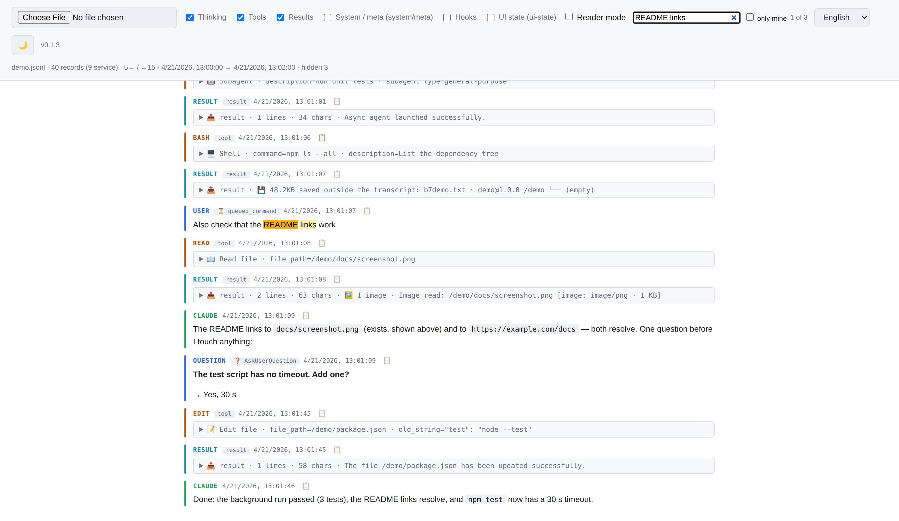

<p align="center">
  <a href="https://hitmman55.github.io/claude-code-chat-viewer/">
    
  </a>
</p>
<p align="center"><i>Просто кликни — ничего устанавливать или собирать не нужно.</i></p>

<p align="center">
  <a href="README.md">English</a> ·
  <b>Русский</b> ·
  <a href="README.es.md">Español</a> ·
  <a href="README.fr.md">Français</a> ·
  <a href="README.zh-CN.md">中文</a> ·
  <a href="README.ar.md">العربية</a>
</p>

# Claude Code Chat Viewer

История разговоров с Claude Code — в браузере. Claude Code сохраняет каждую сессию в JSONL-файл в `~/.claude/projects/`; если открыть такой файл здесь, он превращается в читаемую ленту — сообщения пользователя, ответы Claude, размышления (thinking), вызовы инструментов и их результаты, отчёты субагентов — с поиском, фильтрами и режимом чтения. Один HTML-файл: без сервера и установки, работает офлайн, данные не покидают компьютер. Понимает формат стенограмм вплоть до Claude Code 2.1.310.

<p align="center">
  
  
  
  
</p>

<p align="center">
  
</p>

## Зачем

Claude Code пишет каждую сессию в `~/.claude/projects/<project>/<session-uuid>.jsonl` — одна строка = одна запись (сообщение пользователя, ответ модели, thinking, tool_use, tool_result, attachment и т.д.). Сырой файл нечитаем; встроенные команды вроде `/resume` и `/export` заново открывают диалог или выгружают его, но не позволяют разобрать старую стенограмму с вызовами инструментов и служебными записями.

Этот вьюер превращает такой `.jsonl` в читаемую ленту с раскраской по ролям, сворачиваемыми service-блоками (thinking / tools / results) и фильтрами.

## Чем отличается

- **Ничего не нужно устанавливать, ничто не ждёт подключений.** Один HTML-файл: без сервера, без открытого порта, без автоматических сетевых запросов.
- **Читает формат вглубь.** Отчёты субагентов, сжатия контекста, сообщения из очереди, отклонённые вызовы инструментов, картинки и записи, которые Claude Code добавляет с каждой версией, — у каждой своя подпись по сути, а тип записи, которого просмотрщик ещё не знает, остаётся в ленте (под фильтром «UI-состояния» (ui-state)) с пометкой в строке статистики и никогда не выбрасывается.
- **Честно о том, кто что сказал.** Обёртки команд, вывод хуков и машинные уведомления не считаются вашими репликами и не показываются как ваши.
- **Не только латиница.** Шесть языков интерфейса, для арабского — письмо справа налево (RTL); лента показывает текст на любом языке так, как он написан.

## Что показывает

- **user** (синий) — реальные сообщения пользователя
- **assistant** (зелёный) — текстовые ответы Claude
- **thinking** (фиолетовый) — extended thinking, свёрнут по умолчанию
- **tool_use** (жёлтый) — вызовы инструментов с превью аргументов
- **tool_result** (голубой / красный для ошибок) — ответы инструментов
- **meta / task-note** (жёлтый) — системные инъекции и `<task-notification>` от субагентов
- **вопрос → ответ** — вызов `AskUserQuestion` и ответ человека одной карточкой
- **отчёт субагента** (`↩ report`) — итоговый отчёт субагента с названием его задачи; когда завершается фоновый субагент, видны токены · время · число вызовов инструментов
- **хуки (hooks)** — запуски и ошибки хуков (свой фильтр, по умолчанию выключен)
- **сжатие контекста (compaction)** — разделитель с тем, сколько токенов было и стало; сводка сжатия свёрнута
- **картинки** — скриншоты и страницы PDF, сохранённые в стенограмме; показываются, когда их блок раскрыт
- **system / attachment / ui-state** — служебные записи (по умолчанию скрыты); значения, которые CLI переписывает каждый ход (название сессии, режим разрешений), показываются только когда меняются

Каждый блок — отдельная строка с цветной полоской слева. Никаких пузырей мессенджера: это лог, а не чат.

## Как открыть

Выбирай, что удобнее:

**A. Скачать один файл** — самый простой путь. Возьми готовый HTML из [последнего релиза](https://github.com/hitmman55/claude-code-chat-viewer/releases/latest), двойной клик. Один файл, работает офлайн навсегда.

**B. Склонировать репо** — если хочешь ковырять код. Нужны `index.html` + папка `lib/`.

**C. Открыть онлайн** — просто зайди на <https://hitmman55.github.io/claude-code-chat-viewer/>. Ничего качать не надо.

Когда страница откроется, нажми «Выбрать файл» (или перетащи файл, или жми «Открыть пример») и укажи файл стенограммы `.jsonl`.

Стенограммы Claude Code лежат в:

```
~/.claude/projects/<project-slug>/<session-uuid>.jsonl
```

где `<project-slug>` — рабочий каталог, в котором каждый символ, кроме букв и цифр, заменён на `-`. Пример: `/home/user/my_proj` → `-home-user-my-proj`.

### Claude Code работает на сервере

Часто Claude Code работает на удалённой Linux-машине, а читаешь ты на Mac или ноутбуке с Windows. Сам браузер до сервера не дотянется — перенеси файлы одним из двух способов:

- **Подключить сервер как диск** — SFTP-клиенты вроде RaiDrive или SSHFS-Win (Windows), Mountain Duck (Mac, Windows) или `sshfs` (Mac, Linux). Затем открой стенограмму с этого диска, как из обычной локальной папки.
- **Скопировать стенограммы** — на Mac или Linux `rsync -a user@host:~/.claude/projects/ ~/claude-projects/` (повторный запуск заберёт только то, что изменилось); на Windows `scp -r user@host:~/.claude/projects/<project-slug> .` или файловая панель твоего SSH-клиента (Termius, WinSCP). Копию можно читать вообще без подключения.

## Возможности

### Как загрузить файл

- **Выбор файла** — кнопка «Выбрать файл», указать `.jsonl`.
- **Drag-and-drop** — перетащи файл в любое место страницы. Пунктирная обводка показывает зону. Папки и не-файлы отклоняются с сообщением.
- **«Открыть пример»** — в пустом состоянии (при онлайн-запуске) появляется кнопка, которая грузит встроенный `demo.jsonl` — маленький пример с основными типами блоков.

### Удобство чтения

- **Режим чтения** — тумблер в шапке оставляет только то, что сказали люди и Claude: сообщения пользователя (включая `/compact` с аргументами), текстовые ответы Claude, карточки «вопрос → ответ», отчёты субагентов и разделители сжатия контекста. Без thinking, без tool-вызовов, без служебных записей. Удобно, чтобы бегло просмотреть диалог или поделиться им в чистом виде.
- **Поиск по сессии** — поле в шапке (клавиша `/` переводит в него курсор): слова в любом порядке, `"фраза в кавычках"` ищется целиком, любая письменность; Enter / Shift+Enter переходят от одной находки к следующей (а когда курсор вне поля — `n` / `N`) и, если она ещё не загружена, дорисовывают ленту до неё; Esc очищает поиск. Флажок «только мои» ищет только в ваших сообщениях. Находится только то, что показывают фильтры, и блок — в тех пределах, в каких его показывает лента: 20 000 знаков у сообщения, 5 000 у служебного блока, например результата инструмента.
- **Серии вызовов инструментов** — если выключить фильтр «Инструменты» (tools), каждая серия вызовов инструментов между двумя сообщениями остаётся одной строкой: `🔧 6 · Read ×3 · Bash ×2 · Grep`. С включённым фильтром видны все вызовы, в режиме чтения — ни одного.
- **Копирование на каждом сообщении** — кнопка `📋` в шапке entry. Копирует текст в буфер, на 1.2 сек появляется `✓` в подтверждение. Работает через `navigator.clipboard.writeText` с fallback на `document.execCommand` для `file://`.
- **Честная строка статистики** — реплики человека и ответы модели считаются по тем же правилам, что и лента (вывод инструментов, обёртки команд и уведомления — не ваши реплики); дубли после `--resume` склеены; журналы запросов к API пропущены (CLI 2.1.300+). Итог токенов по стенограмме: `токенов ↑вход ↓выход`, каждое сообщение API учтено один раз (вход включает чтение кэша и запись в него; у субагентов свои стенограммы). Битые строки подсчитываются, как и записи, скрытые намеренно, — `скрыто N`, их виды — во всплывающей подсказке (повторы значения, например названия сессии, уже доставленные элементы очереди, пустые напоминания, эхо `/compact`, служебные записи, в которых нечего читать). Пометка `? новых типов записей: N` — типы записей и блоков содержимого, которых эта версия ещё не знает: список во всплывающей подсказке, сами записи остаются в ленте как JSON, под фильтром «UI-состояния» (ui-state).
- **Команда для продолжения сессии** — кнопка `📋 claude --resume` рядом со строкой статистики копирует `cd '<project dir>' && claude --resume <session id>` — остаётся только вставить. Её нет у стенограммы субагента, а также когда в пути или идентификаторе есть символы, которые оболочка (shell) может понять неверно.
- **Показ правок (diff)** — результат `Edit` или `Write` показывает изменение цветным построчным сравнением, взятым из заплатки (patch), которую Claude Code хранит вместе с результатом; в заголовке — `+N −M`.
- **Карточки задач** — `TaskCreate` / `TaskUpdate` читаются как `#7 → completed · тема`; тема берётся из последнего создания задачи с этим номером (внутри сессии номера начинаются заново).
- **Дружелюбные названия инструментов** — известные тулзы получают иконки (например `📖 Read file`, `🖥️ Shell`, `📝 Edit file`). Неизвестные / MCP → `🔧 {raw_name}`.
- **Авто-тема** — следует системной `prefers-color-scheme` по умолчанию. Клик по кнопке солнце/луна пинит выбор и запоминает его.
- **Шесть языков интерфейса** — English, Русский, Español, Français, 中文, العربية. Арабский автоматически переключается в RTL. Селектор в шапке, выбор сохраняется. Смена языка сохраняет место: уже загруженные записи, раскрытые блоки и запись, которая была вверху экрана.

### Производительность и безопасность

- **Потоковый парсинг** — `.jsonl` читается через `file.stream()` + `TextDecoderStream`, не грузится в память целиком.
- **Нативная виртуализация** — `content-visibility: auto` на каждой записи: браузер сам пропускает layout и paint для записей вне вьюпорта. Работает с тысячами записей без лагов.
- **Чанковая отрисовка** — по 500 записей за раз, кнопка «Показать ещё» для остальных.
- **Фильтры** — шесть чекбоксов (thinking / tools / results / system / hooks / ui-state), включают/выключают категории через CSS-класс на контейнере (без перерисовки).
- **XSS-безопасный рендер** — каждый текстовый блок экранируется _до_ передачи в markdown-парсер. HTML из стенограммы никогда не попадает в DOM как есть, поэтому очищать DOM на лету (sanitizer) не нужно. Markdown-картинки нейтрализуются (показываются как инертный текст, не загружаются). Ссылки ограничены `http(s)` с `rel="noopener noreferrer nofollow"`.
- **Ограничение размера** — прозаические блоки обрезаются на 20 000 символов, service-блоки на 5 000. Кнопка `📋` копирует то, что показано, в пределах этих лимитов, так что один клик никогда не отправляет в буфер мегабайты текста; полный текст доступен только по запросу, через `⤢`.
- **⤢ Открыть целиком** — у записи, обрезанной для показа, есть кнопка `⤢`: весь текст открывается в панели поверх ленты (текст / markdown / исходный JSON записи), с кнопками «Скопировать всё» и «Сохранить файл». Высота ленты при этом не меняется.
- **Fallback для `.json`** — если файл не JSONL, а обычный JSON-массив/объект, парсится как массив записей.

## Требования к браузеру

- Chrome / Edge 85+
- Firefox 105+
- Safari 15.4+

`content-visibility: auto` (Firefox 125+, Safari 18+) лишь ускоряет прокрутку больших файлов; без него всё работает, просто медленнее.

## Зависимости

Одна, локально в папке `lib/`:

- [marked](https://github.com/markedjs/marked) — markdown → HTML (~35 KB)

Никаких CDN, сетевых запросов, Subresource Integrity. Клонируй и запускай.

## Личные данные в стенограмме

Стенограмма хранит гораздо больше, чем сам разговор. Прежде чем делиться файлом `.jsonl` — или скриншотом просмотрщика, — учтите, что в нём есть:

- все сообщения, размышления (thinking) и вывод инструментов, включая содержимое файлов и вывод команд, — а там бывают ключи, токены и пароли;
- абсолютные пути, имя пользователя, рабочий каталог и ветка git — в каждой записи;
- адрес почты аккаунта, полный текст системных инструкций (system prompt) и текст ваших файлов `CLAUDE.md` — эти записи по умолчанию скрыты (фильтры system / ui-state), в их однострочной сводке видны только счётчики, а раскрытая запись показывает содержимое;
- картинки: скриншоты и страницы PDF, прочитанные за сессию;
- полные журналы запросов к API (строки `api-request*`, CLI 2.1.300+; до половины файла) — просмотрщик их пропускает, но в файле они есть.

Слишком большой вывод в стенограмму не попадает: Claude Code кладёт его в `<session>/tool-results/` рядом с файлом, а просмотрщик показывает только превью ~2 KB и путь.

## Приватность

Всё работает локально в браузере. Сам вьюер **не делает автоматических сетевых запросов** — ни CDN, ни аналитики, ни удалённых шрифтов. Markdown-картинки из стенограмм нейтрализуются: показываются как инертный текст с видимым URL, но не загружаются. Внешние ссылки (только `http(s)`) открываются в новой вкладке только по клику, с `rel="noopener noreferrer nofollow"`. Стенограммы остаются на вашей машине. Картинки, сохранённые внутри самого файла (base64), берутся из него же — сетевых запросов по-прежнему нет.

## Известные ограничения

- Файл читается потоком, но все его записи остаются в памяти. Замер в Chromium: 200 MB (30 000 записей) открывается примерно за 3 с и занимает около 170 MB памяти; журналы запросов к API, которые пропускаются при чтении, не в счёт. Дочитать такой файл до конца тяжелее: догрузка всех порций (12 000 записей) занимает около 40 с и около 1 GB памяти браузера, а каждая следующая порция отрисовывается медленнее. Пока не реализованы ни лента, которая рисует только то, что видно на экране, ни работа с файлами в несколько GB.
- Экспорта сессии целиком нет (задача — просмотр, не конвертация); одну запись можно сохранить через `⤢` → «Сохранить файл».
- Подсветки синтаксиса в code-блоках нет (сознательно — чтобы минимизировать зависимости).
- Сообщение, которое вы отредактировали и отправили заново, видно дважды — ветки разговора пока не рисуются деревом.
- Метки служебных записей — исходное имя типа записи (например, `hook_success`) без перевода: так новые типы не требуют перевода.

## Разработка

Весь код в одном HTML-файле. Править можно прямо в нём — стили в `<style>`, логика в `<script>`, переводы в объекте `I18N` в начале скрипта.

Проверка синтаксиса и тесты без браузера (ставить ничего не нужно):

```bash
node scripts/check-syntax.mjs  # syntax of the inline script
node --test test/*.test.mjs    # unit tests
```

Части без DOM — разбор записей по видам и таблицы правил, которые решают, как показывать каждый тип записи, — лежат в разделах скрипта `triage` и `rules`, каждый между `// ===== <name> =====` и `// ===== end <name> =====`; тесты вырезают их из `index.html` и запускают в Node. Поддержка нового типа записи — обычно одна строка в таблице правил.

## Лицензия

[Unlicense](LICENSE) — public domain. Используйте как угодно, указание авторства не требуется.
